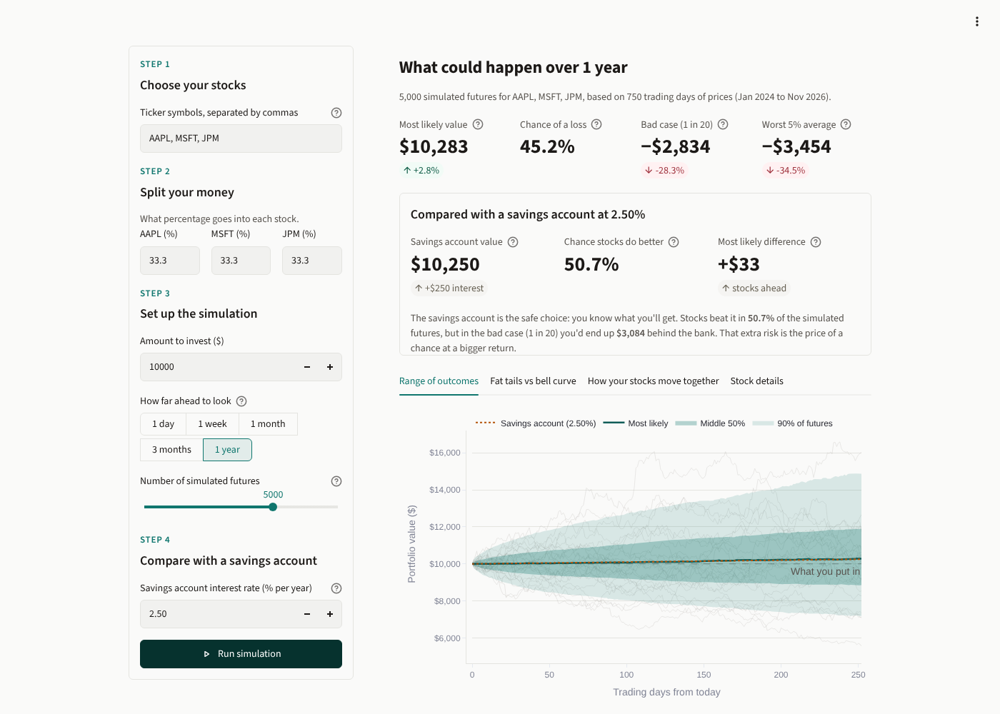

# Portfolio Risk Simulator

A web app that runs a Monte Carlo simulation on a portfolio of real stocks. It uses fat-tailed (Student's t) shocks and correlated returns (Cholesky decomposition), then reports the likely range of outcomes, Value at Risk (VaR) and Conditional VaR (CVaR).

**Live app:** (https://montecarloportfoliosim.streamlit.app)



## What it does
- Downloads about 3 years of daily prices from Yahoo Finance (`yfinance`)
- Estimates each stock's drift and volatility, and how the stocks move together (covariance)
- Fits a Student's t-distribution to capture extreme days
- Compares the portfolio with a savings account at an interest rate you choose
- Light and dark themes (matches the device; switch in the ⋮ menu → Settings)
- Simulates thousands of futures and compares fat-tailed risk with a normal-distribution model

## Files
| File | Purpose |
|---|---|
| `monte_carlo_portfolio.py` | The model: data, parameter estimates, simulation and risk measures |
| `app.py` | The Streamlit website (inputs, charts, wording) |
| `requirements.txt` | Python packages the app needs |
| `.streamlit/config.toml` | Theme. Change `primaryColor` here (and `BRAND` in `app.py`) to re-colour the app |

## Run it on your computer
```bash
pip install -r requirements.txt
streamlit run app.py
```
It opens at http://localhost:8501.

## Publish it for free (Streamlit Community Cloud)
1. Create a free account at https://github.com and make a **new public repository**,
   for example `portfolio-risk-simulator`.
2. Upload these files to it, keeping the `.streamlit` folder:
   `app.py`, `monte_carlo_portfolio.py`, `requirements.txt`, `README.md`, `.streamlit/config.toml`.
   (On the repo page: **Add file → Upload files**. Folders starting with a dot can be hidden on
   some computers, so if `.streamlit` doesn't show up, use **Add file → Create new file** and
   type `.streamlit/config.toml` as the name, then paste the contents in.)
3. Go to https://share.streamlit.io and sign in with GitHub. Allow it to access your repositories.
4. Select **Create app**, then choose to deploy from an existing GitHub repo.
5. Pick your repository, branch `main`, and main file `app.py`. You can choose a custom
   address such as `yourname-portfolio-risk.streamlit.app`.
6. Select **Deploy**. The first build takes a few minutes while it installs packages.

To update the live site, edit the files on GitHub (or push changes). The app redeploys
automatically.

**If Yahoo Finance stops responding:** free shared servers sometimes get rate-limited by
Yahoo. The app shows a "couldn't reach Yahoo Finance" message instead of crashing. Waiting
a few minutes usually fixes it, and prices are cached for an hour to keep requests low.

## Limitations
The model assumes the future behaves like the last 3 years, uses a buy-and-hold portfolio
with no rebalancing, and is for learning about risk, not financial advice.
